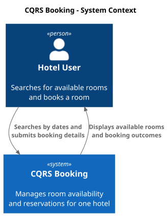

# 3. System Scope and Context

## Business Context

CQRS Booking enables a hotel user to search for available rooms and make reservations for a single hotel. The system maintains authoritative reservation records and an up-to-date availability read projection.

## System Boundary

**Inside the boundary:**
- Web application components (Flask routes, services, domain logic)
- SQLite database storing reservations and availability

**Outside the boundary:**
- Hotel User (browser-based interface)

No external service integrations are planned.

## External Interactions

### Hotel User
- **Searches availability** by providing arrival and departure dates
- **Books a room** by submitting:
  - client identifier
  - room name
  - arrival date
  - departure date
- **Receives feedback** on available rooms and booking outcomes

### Browser-to-Application Communication (proposed routes)
- **HTTP GET** `/availability` — Renders HTML form and displays available rooms for given dates
- **HTTP POST** `/book` — Processes booking submission and displays outcome

Flask renders HTML pages and forms, consistent with ADR-001.

## Diagram

PlantUML source: [c4-context.puml](diagrams/c4-context.puml)
