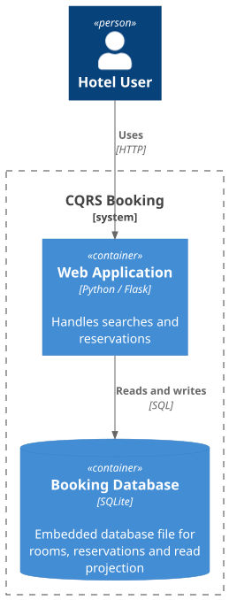
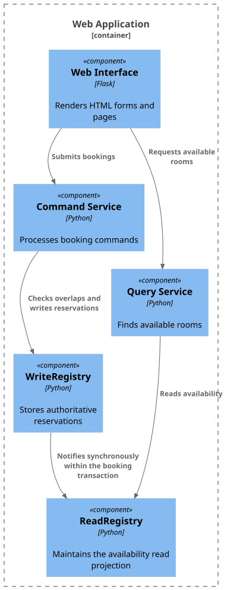

# 5. Building Block View

## Containers

The system is packaged as one Flask application using SQLite for persistence.

PlantUML source: [c4-container.puml](diagrams/c4-container.puml)

| Container | Technology | Responsibility |
|-----------|------------|----------------|
| Web Application | Python / Flask | Handles searches and reservations via HTTP routes and HTML rendering |
| Booking Database | SQLite | Embedded database file for rooms, reservations and the availability read projection |

## Components

The Flask application contains five key components.

PlantUML source: [c4-component-booking.puml](diagrams/c4-component-booking.puml)

| Component | Technology | Responsibility |
|-----------|------------|----------------|
| Web Interface | Flask | Renders HTML forms and pages, routes HTTP requests to services |
| Command Service | Python | Processes booking commands, validates inputs, performs overlap checks against authoritative reservations |
| WriteRegistry | Python | Stores authoritative reservations in SQLite within a serialized transaction |
| ReadRegistry | Python | Maintains the availability read projection; updated synchronously within the booking transaction |
| Query Service | Python | Finds available rooms for date ranges by querying ReadRegistry |

## Component Dependencies

- **Web Interface** → **Command Service** — Submits bookings
- **Command Service** → **WriteRegistry** — Checks overlaps and writes reservations
- **WriteRegistry** → **ReadRegistry** — Notifies synchronously within the booking transaction
- **Web Interface** → **Query Service** — Requests available rooms
- **Query Service** → **ReadRegistry** — Reads availability

The command and query paths are strictly separated per CQRS. ReadRegistry updates occur in the same transaction as reservation writes to maintain consistency.
