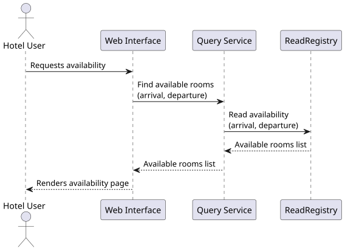
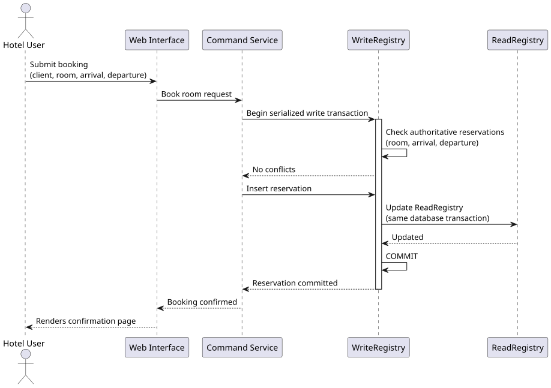
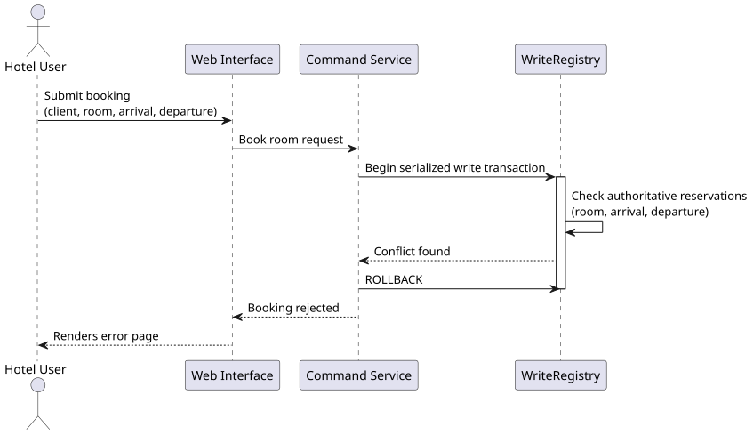

# 6. Runtime View

## Search Available Rooms

PlantUML source: [runtime-search.puml](diagrams/runtime-search.puml)

1. Hotel User requests availability via Web Interface
2. Web Interface delegates to Query Service
3. Query Service reads availability from ReadRegistry
4. ReadRegistry returns available rooms
5. Query Service returns list to Web Interface
6. Web Interface renders availability page

## Successful Booking

PlantUML source: [runtime-book-success.puml](diagrams/runtime-book-success.puml)

1. Hotel User submits booking request via Web Interface
2. Web Interface delegates to Command Service
3. Command Service instructs WriteRegistry to begin a serialized write transaction
4. WriteRegistry checks authoritative reservations for conflicts
5. WriteRegistry reports no conflicts
6. WriteRegistry inserts the reservation
7. WriteRegistry calls ReadRegistry to update the projection using the same database transaction
8. ReadRegistry updates and confirms
9. WriteRegistry COMMITs the transaction
10. Command Service returns booking confirmation
11. Web Interface renders confirmation page

## Reject Overlapping Booking

PlantUML source: [runtime-book-reject.puml](diagrams/runtime-book-reject.puml)

1. Hotel User submits booking request via Web Interface
2. Web Interface delegates to Command Service
3. Command Service instructs WriteRegistry to begin a serialized write transaction
4. WriteRegistry checks authoritative reservations for conflicts
5. WriteRegistry reports conflict found
6. WriteRegistry performs ROLLBACK
7. Command Service returns booking rejection
8. Web Interface renders error page

Any insertion or projection-update failure triggers a ROLLBACK of the entire transaction, ensuring atomic consistency between reservations and availability.
