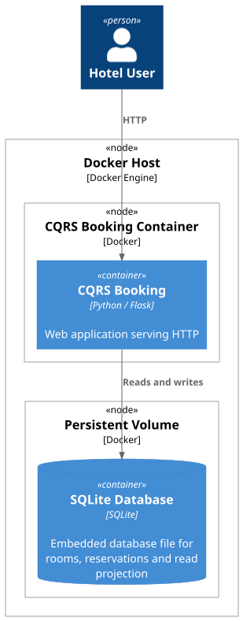

# 7. Deployment View

## Planned Deployment Architecture

The application is planned to run locally in Docker for development and testing.

PlantUML source: [deployment.puml](diagrams/deployment.puml)

### Docker Host
Contains one Docker application container and one persistent volume:
- **CQRS Booking Container** — Docker container running the Flask web application
- **Persistent Volume** — Docker volume mounting the SQLite database file for rooms, reservations, and read projection

### External Actors
- **Hotel User** — Accesses the application through a browser over HTTP

### Execution Modes

| Mode | Behavior |
|------|----------|
| Application | Flask serves HTTP; runs in Docker container with volume mounted |
| CI Testing | pytest runs inside the test container and exits after completion |

This is the planned architecture. Docker setup and CI/CD pipelines are not yet implemented.
